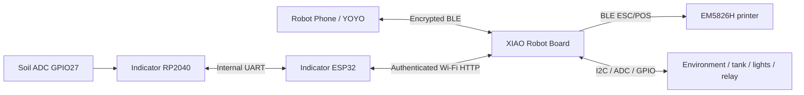

# Skill and three-device engineering API

This English interface guide describes the implementation in the repository. Field evidence and platform-installed versions are tracked separately in [acceptance](acceptance.md). HTTP schema version 1, the public BLE prefix `V`, and Skill package 1.0.3 are different version numbers.

## Ownership and transport

| Component | Responsibility |
| --- | --- |
| Robot Phone / YOYO | Intent, conversation, official `ble_send_command`, interpreting actual responses |
| XIAO ESP32-S3 Plus | BLE server for phone, HTTP server for Indicator, BLE client for printer; calibration, validation, deduplication, timing and actuator guards |
| Indicator ESP32 | Touch interface, HTTP requests, frozen print preview and visible connection stages |
| Indicator RP2040 | Soil ADC on GPIO27, internal UART responder and passive buzzer on GPIO19 |
| EM5826H | Receives BLE ESC/POS bitmap and cut data |



Calibration and saved preferences live on XIAO. Soil samples originate on the Indicator RP2040 and reach XIAO through the screen's HTTP upload. A focus session uses XIAO's monotonic clock; disconnecting the phone does not stop it, but restarting the controller clears the in-memory session. Game state belongs to the screen and is separate from physical sensor validity.

## Phone BLE service

| Parameter | Value |
| --- | --- |
| Prototype device name | `RoboPlanter-A994`; replace when using another controller |
| Service UUID | `a2f39c10-7e4b-4d21-8a61-0f3bc9d15001` |
| Characteristic UUID | `a2f39c11-7e4b-4d21-8a61-0f3bc9d15001` |
| Encoding | UTF-8; one command per official tool call |
| Authorization | System BLE pairing, encryption and the stored owner bond; no password in SKILL.md |

An official tool request for a soil read:

```json
{
  "device_name": "RoboPlanter-A994",
  "service_uuid": "a2f39c10-7e4b-4d21-8a61-0f3bc9d15001",
  "characteristic_uuid": "a2f39c11-7e4b-4d21-8a61-0f3bc9d15001",
  "command_array": [{"command": "V|S|soil", "delay_ms": 0}],
  "encoding": "utf-8",
  "ack_type": "ack",
  "expect_response": true,
  "response_timeout_ms": 3000
}
```

`V` is a public protocol marker, not an access token. The root Skill contains the exact command allowlist; natural-language input is never forwarded as an arbitrary hardware instruction.

| Purpose | Command |
| --- | --- |
| Soil percentage | `V\|S\|soil` |
| Raw ADC, explicit diagnostics only | `V\|S\|soil_raw` |
| Temperature/humidity | `V\|S\|env` |
| Ambient light / particles / VOC / tank | `V\|S\|ambient`, `V\|S\|pm25`, `V\|S\|voc`, `V\|S\|tank` |
| Fill light on / off | `V\|C\|id\|light\|1` / `V\|C\|id\|light\|0` |
| Start a 25-minute focus session | `V\|C\|id\|focus_start\|1500000` |
| Pause / resume / reset | `V\|C\|id\|focus_pause`, `V\|C\|id\|focus_resume`, `V\|C\|id\|focus_reset` |
| Focus state | `V\|S\|focus` |
| Auto scene-print preference | `V\|C\|id\|auto_print\|0` / `V\|C\|id\|auto_print\|1` |
| Result for an existing action | `V\|R\|id` |
| Emergency pump stop | `V\|C\|id\|stop_water` |

Each new action needs a fresh eight-character alphanumeric request ID. Keep the **same ID** while checking that action; never turn a timeout into a new action ID. The timer duration range is 1–120 minutes. Voice-started watering is intentionally absent from the current Skill's action table.

## Reading response values

`Soil:65% calibrated` is a calibrated relative percentage. `Soil:uncalibrated` means missing reference points; `Soil:unavailable` means no usable sample. `Soil:0% calibrated` is valid. `ADC:…` belongs to diagnostics, not ordinary moisture answers.

The compatibility desk summary uses explicit units, for example `S65% T25.1C H49%`. Do not apply the old tenths-of-a-degree conversion again to a number that already includes its decimal and unit. For precise legacy parsing and all business error strings, use the [versioned BLE contract](../../../integrations/yoyo/skill-draft/references/ble-contract.md).

## Indicator HTTP API

Every request uses the device's private `X-Device-Token` header. Keep it in local configuration, never in the published Skill or screenshots.

| Endpoint | Purpose |
| --- | --- |
| `GET /api/v1/state` | Sensor validity, calibration, light, focus, printer, pairing and latest action state |
| `POST /api/v1/command` | A validated, request-ID-based operation |
| `GET /api/v1/result?request_id=…` | Query one action, even if another interface changed the latest-action field |
| `POST /api/v1/calibration` | Revision-checked calibration update |
| `POST /api/v1/auto-light` | Revision-checked light thresholds |
| `POST /api/v1/sensors/soil` | Authorized Indicator soil upload when remote soil is enabled |

Use the complete [HTTP device protocol](../../device-protocol.md) for JSON bodies, limits, freshness, revision conflicts and validation. Accepted means queued/started, not physically complete. A result missing after reboot does not prove that an action never occurred.

## Visible recovery and printing

Normal phone recovery uses `reconnect_yoyo`: release the current link, retain the owner bond and resume advertising. Completed means ready for the phone to reconnect, not that reconnection already happened. Only explicit re-binding clears ownership.

A print request freezes the ticket → XIAO queues it → formats a 384-dot bitmap → sends tested 128-row raster bands over BLE → sends feed/cut data → records the result. The printer uses service `0x18F0` and write characteristic `0x2AF1`. Software transmission completion is not a paper or cutter-position measurement. Query the original result after a timeout; do not blindly resend.

