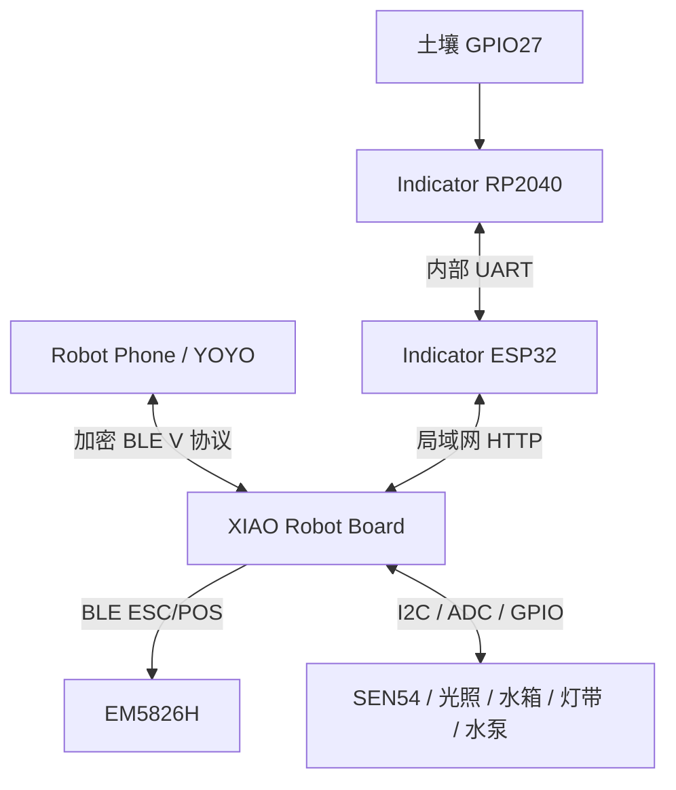
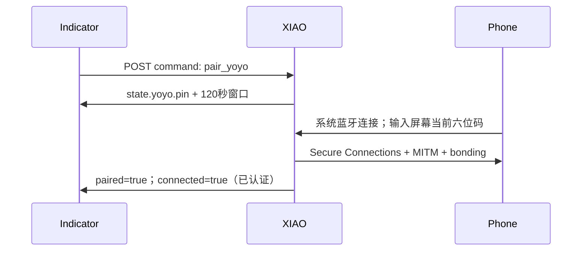
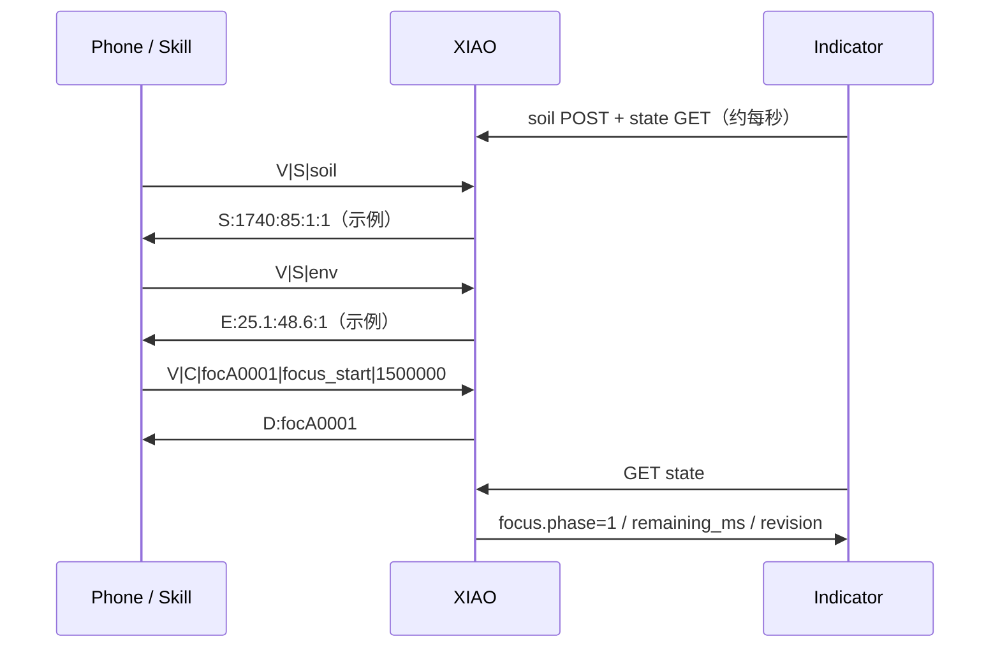
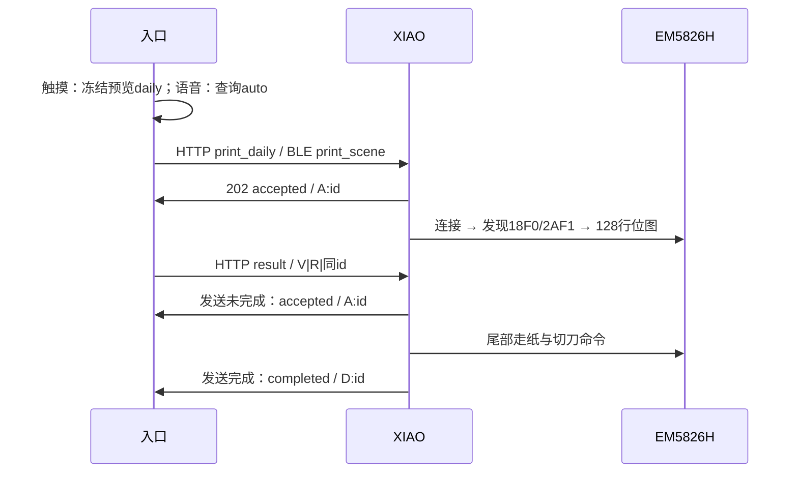
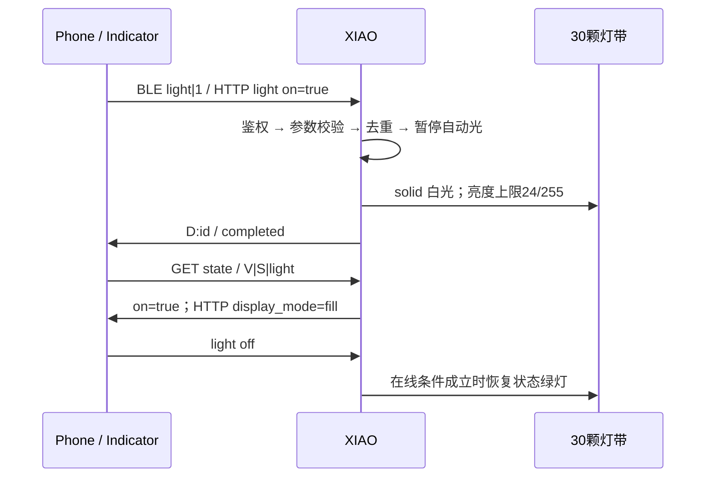

# YOYO工位绿植搭子 · Skill 与三端工程 API

作者：潘石 · 彼得潘的科技谷

基线：39606ca + 2026-11-04连接恢复修订 / 本地 Skill 1.0.2

## 01 / 接口范围与版本

本文覆盖 Robot Phone、XIAO Robot Board、SenseCAP Indicator 和 BLE 打印机之间的实际工程接口。基于源码39606ca及2026-11-04连接恢复修订，Skill源文件为1.0.2；这是实现快照，不等同于荣耀平台当前审核或手机安装版本。文中数值、请求号与回包均为格式示例，不是实时遥测。

| 组件 | 职责与实现入口 |
| --- | --- |
| Robot Phone / YOYO | 理解自然语言；运行私有 Skill；调用官方 ble_send_command；接收业务通知并转述。 |
| XIAO ESP32-S3 Plus | 唯一硬件控制与状态汇聚点：BLE 服务端、HTTP 服务端、打印机 BLE 客户端；校准、去重、限流、计时、执行器保护。 |
| Indicator ESP32-S3 | 触摸 UI、HTTP 客户端、预览冻结、Wi-Fi/语言/亮度设置；显示配对码。 |
| Indicator RP2040 | GPIO27 采土壤，内置 UART 向 ESP32 应答；GPIO19 无源蜂鸣器。 |
| EM5826H | 接收 XIAO 发送的 ESC/POS 位图及切纸命令；当前走 BLE。 |

协议版本分开理解：HTTP schema_version=1；BLE 使用公开前缀 V（文档称 v2）；本地 Skill 包版本1.0.2。V 不是密钥，也不代表 HTTP schema。设备名示例 RoboPlanter-A994 的后缀由 XIAO 芯片身份生成，复制到另一台设备必须同步修改 Skill 配置。

> 当前主线：手机 → BLE → XIAO；Indicator ↔ Wi-Fi/HTTP ↔ XIAO；XIAO → BLE → 打印机。手机不与 Indicator 蓝牙配对。云 MCP/MQTT 是可选辅助入口，A2A 未实现。

## 02 / 三端与外设的连接拓扑



| 链路 | 方向 / 传输 | 承载内容 |
| --- | --- | --- |
| L1 对话 | Phone ↔ XIAO / 加密 BLE | 短文本 V 命令；NOTIFY 返回业务结果。 |
| L2 可视化 | Indicator ↔ XIAO / HTTP | 状态查询、设置、触摸动作；土壤样本反向上传。 |
| L3 内部采集 | RP2040 ↔ ESP32 / UART | 115200 8N1；挑战、ADC、CRC；蜂鸣器提示。 |
| L4 纸质输出 | XIAO → EM5826H / BLE | 0x18F0 服务、0x2AF1 写特征；384 点位图。 |

两板分别供电，不用外接 UART、I²C 或 USB 数据线互连。当前样机采用同一路由器的 2.4GHz Wi-Fi；源码还保留 XIAO AP 模式（192.168.4.1）。这两种网络配置不能混用。给主控设置 DHCP 地址保留可减少重启后失联。

## 03 / 谁保存数据，谁说了算

| 状态 | 唯一来源 / 持久化 | 屏幕与语音怎样使用 |
| --- | --- | --- |
| 土壤原始值 | RP2040 ADC → Indicator → XIAO；样本在 RAM | XIAO 校准后提供百分比；有效期独立检查。 |
| 干湿/水箱校准 | XIAO NVS，带 revision 与校验 | Indicator 编辑；YOYO 只读取换算结果。 |
| 温湿度/PM/VOC/光 | XIAO 传感器采样任务 | 读取同一份最新样本；失效显示缺失，不补零。 |
| 番茄钟 | XIAO 单调计时；RAM | 手机与屏幕共同控制；手机断开仍走时，主控断电清零。 |
| 自动打印开关 | XIAO rp-companion NVS | 语音和屏幕均可修改；重启保留。 |
| 手机绑定 | XIAO BLE 栈 bond + owner NVS | Indicator 仅显示本次码；正常重连无需重新登记。 |
| Wi-Fi/语言/亮度 | Indicator 本地设置；私有配置信息 | 正常断电保留；花盆地址/令牌按项目配置。 |
| 游戏成长/品种 | Indicator 养成模型与存储 | 游戏生命值不替代真实传感器或泵保护。 |
| 打印任务/去重 | XIAO RAM；每次启动 64 条 | 同 id 同内容不重做；断电不提供永久恰好一次保证。 |

> “联网”“已绑定”“链路连接”“本次业务成功”是四种不同状态。灯带绿色只表达主控网络就绪且 Indicator 土壤上传仍新鲜（在线判断预算 10 秒），不表示手机或打印机始终连接。

## 04 / Skill 如何把对话变成动作

Skill 是交互政策与工具使用契约，不是常驻固件。先识别用户此刻的意图，再选白名单命令；固件负责最终校验。自然语言不能直接透传为串口或任意设备指令。

| 意图层 | 工具策略 | 用户可见回应 |
| --- | --- | --- |
| 问候 / 吐槽 / 陪聊 | 不调用硬件；每轮一至两句 | 承接情境，不播报菜单，不伪造设备观察。 |
| 读取工位 | 分开查询 soil、env | 只合并有效字段；土壤优先校准百分比。 |
| 明确动作 | 新建 id → 发 C → 查 R | 先“已提交”；只有业务回包支持才说已设置。 |
| 打卡 / 午饭 / 会议 / 休息 / 低电量 | 先 S\|auto；AUTO:1 才自动发场景票 | 每轮最多一张；引用、否定、追问不再次打印。 |
| 时间提醒 | create_schedule 或 create_alarm | 用平台实际 schema；确认工具成功才说已创建。 |
| 退出伙伴 | 仅明确要求时 skill_exit | 不因“谢谢”“我去忙了”自动退出。 |

allowed-tools：ble_send_command、create_schedule、create_alarm、check_schedule、skill_exit。当前 Skill 不调用 MCP，也不调用未知脚本；官方日程工具的具体参数 schema 由平台提供，本工程没有复制或猜测它。

“继续”只有在上文明确暂停番茄钟时映射 focus_resume；“别打印这次”只压制当前票；“以后别自动打印”写持久开关；“停泵”优先于闲聊和打印。浇水启动在此 Skill 中未开放。

## 05 / 首次配对与重新绑定



pair_yoyo 只在未绑定、无活动手机连接、非修复中开放。窗口已开时重复请求不会换码。固件保存唯一 owner；下一次连接仍要通过加密认证，系统列表出现设备不是权限证明。

```text
{"request_id":"screen-pair-01","action":"pair_yoyo"}
{"request_id":"screen-reconnect-01","action":"reconnect_yoyo"}
{"request_id":"screen-repair-01","action":"repair_yoyo"}
```

普通恢复先用 **重连手机（保留绑定）**，发送 `reconnect_yoyo`：存在手机链接时返回 accepted，主控只断开当前手机链接，收到断开事件后结果变为 completed 并恢复广播。原本无活动链接时直接恢复广播并返回 completed。completed 表示设备已准备好再次连接，**不是手机已重新连接**；手机需打开工位小芽并说“读取工位状态”。5秒内未收到断开事件返回 `phone_disconnect_timeout`；栈拒绝断开返回 `phone_disconnect_failed`。同一最近请求号可用 `/api/v1/result` 核对，重发同号返回缓存结果；结果丢失时客户端不自动重发。

该操作保留 phone bond / owner、Wi-Fi、标定、打印机 BLE 客户端和已经接受的执行任务；不重启整个蓝牙栈。仅允许已绑定、非修复/重连中的设备执行。HTTP 仍须可信网络和 `X-Device-Token`，Skill 不可调用这条本地设置命令。

只有换手机或普通重连仍无法解决旧绑定异常，才在手机忽略旧记录并断开；Indicator 选择“重新绑定手机”并明确确认后发送 repair_yoyo。XIAO 清理栈中的旧 bond 和持久 owner，成功后开启新窗口。活动连接会拒绝修复（phone_link_active）；不直接清空全部 NVS。

GET state 的 yoyo 字段：paired=有登记；link_connected=底层链接存在；connected=本次已认证；pairing=窗口开放；window_remaining_ms=剩余时间；pin 仅在窗口内出现。stage / failure_reason / encryption_error 用于定位，不作为成功依据。

连接中心新增以下字段（旧固件缺失字段时默认不支持，不能据此开放按钮）：

| 字段 | 类型 | 语义 |
| --- | --- | --- |
| reconnect_supported | boolean | 支持保留绑定的手机重连命令。 |
| reconnecting | boolean | 已请求释放手机链接，正在等待断开事件。 |
| notifications | boolean | 当前手机连接已订阅回复特征；不是回复送达证明。 |
| tool_seen | boolean | 最近这次手机连接内，至少一条已认证工具请求被主控处理；包含业务错误结果。 |
| tool_count | uint32 | 最近这次手机连接已处理的工具请求数量，新连接时清零。 |
| last_tool_age_ms | uint32，可缺失 | 最近一次处理工具请求距当前的毫秒数；tool_seen=false 时省略。不含指令文本、打印内容或凭据。 |

Indicator 仅使用5秒内的可信状态；过期或切换网络后隐藏旧配对码，禁用设备控制。配对码倒计时以响应的 window_remaining_ms 减本地经过时间显示，不能因屏幕刷新延长窗口。连接中心分开显示 Wi-Fi、HTTP 主控状态和手机 BLE 状态，技能是否正常需实际只读请求验证，单说“你好”不算硬件验证。

Wi-Fi 自动重试等待30秒，单次连接最多20秒，页面显示尝试编号及剩余等待。**重新连接 Wi-Fi** 重试当前凭据且不删除或重写已保存配置；**连接花盆网络** 选择预配置网络，成功联网后再保存；**立即检查链路** 只请求读状态，不切换网络、不重复执行动作。首次输入错误密码不自动循环尝试，已有网络的临时握手失败允许自动恢复。

## 06 / BLE 传输与工具参数

| 项目 | 约定 |
| --- | --- |
| 设备名 | RoboPlanter-A994（本样机；换主控需同步 Skill） |
| Service UUID | a2f39c10-7e4b-4d21-8a61-0f3bc9d15001 |
| Characteristic UUID | a2f39c11-7e4b-4d21-8a61-0f3bc9d15001 |
| 属性 / 权限 | WRITE + NOTIFY；加密 MITM 写；先订阅 CCCD 通知。 |
| 编码 / 长度 | UTF-8；每条命令最多 240 字节；禁止 NUL。 |
| MTU / 长写 | 请求 MTU 247；ATT 长写按连接和 offset 组装；Skill 不自行拆命令。 |
| 回包 | 单条 NOTIFY 最多 20 字节，无多段拼包。GATT ACK 不等于业务完成。 |

```text
{
  "device_name": "RoboPlanter-A994",
  "service_uuid": "a2f39c10-7e4b-4d21-8a61-0f3bc9d15001",
  "characteristic_uuid": "a2f39c11-7e4b-4d21-8a61-0f3bc9d15001",
  "command_array": [{"command":"V|S|soil","delay_ms":0}],
  "encoding":"utf-8", "ack_type":"ack",
  "expect_response":true, "response_timeout_ms":3000
}
```

每次只发送一条命令，避免无 request_id 的查询回包串台。内部 BleTicket 由连接号和递增世代组成，回包只送原连接；断线后的旧任务不能借用相同连接号向新连接发送。

## 07 / BLE 读接口

| 字段 | 业务回包格式 | 解释 |
| --- | --- | --- |
| soil | S:raw:percent:valid:calibrated | ADC；相对土壤湿度%；有效/已校准标记。 |
| env | E:temperature:humidity:valid | 摄氏度；空气相对湿度%。 |
| ambient | B:raw:valid | 环境光 ADC 0–4095，不是 lux。 |
| pm25 | M:value:valid | PM2.5，µg/m³。 |
| voc | V:value:valid | VOC 指数，不是气体浓度或 CO₂。 |
| tank | W:distance_mm:valid | 探头距离；BLE 不返回水箱百分比。 |
| focus | F:phase:remaining_s:duration_s | phase 0待机 / 1计时 / 2暂停 / 3完成。 |
| light | L:enabled:on | 功能启用、补光/手动灯效逻辑开关。 |
| pump | P:enabled:on:remaining_ms | 功能启用、是否运行、剩余毫秒。 |
| printer | T:enabled:status | off/idle/queued/sent/fail；sent 不证明出纸。 |
| auto | AUTO:0 或 AUTO:1 | 场景自动打印开关。 |

兼容字段 desk→K:raw:temperature10:humidity（温度除10），以及 air→A:raw:valid、uv→U:raw:valid 仍在固件中。当前日常 Skill 不使用 desk，当前硬件以 SEN54 与 Light 替代旧 Air/UV。

按字段解析：env 的 E:25.1:48.6:1 是数据，不是错误；错误 E:STALE、E:FIELD 等应按结构区分。未知值可为 x 或带 valid=0 的数字，不能单独依据数值判断可用。

## 08 / 土壤百分比与实时语义

```text
V|S|soil  →  S:1740:85:1:1
V|S|env   →  E:25.1:48.6:1
```

以上是格式示例：只有 valid=1 且 calibrated=1，percent 为0–100数值，才说“土壤湿度约85%”。换算由 XIAO 使用 NVS 干湿两点完成，屏幕和 YOYO 不各自再算一遍。0% 是有效数值；x 不是0。

| 回包示例 | 正确呈现 |
| --- | --- |
| S:1740:x:1:0 | 土壤还没校准；引导到屏幕干湿校准。 |
| S:1740:x:0:1 | 暂时没有有效土壤读数；不复用上次百分比。 |
| S:2700:0:1:1 | 土壤相对湿度约0%；不是“传感器没数据”。 |
| E:x:x:0 | 暂无有效温湿度；不掩盖独立有效的土壤数据。 |
| E:STALE | 采样超时；不以工具成功代替数据新鲜。 |

“实时”在这里指带有效性约束的最近采样，不是发一句话就同步重新测量所有传感器。XIAO 常规采样约每秒；Indicator 土壤经过内部串口与HTTP转发。土壤 age=上报年龄+保守传输预算1500ms+接收后时间，超过3000ms失效。

土壤百分比是干湿标定的相对刻度，不是实验室体积含水率。游戏生命值、空气湿度、土壤相对湿度分开显示。植物不同，浇水阈值不能从一个通用百分比推断。

## 09 / BLE 动作与请求号

| 动作 | 命令例子（示例 id 不能复用） |
| --- | --- |
| 白光开 / 关 | V\|C\|lmpA0001\|light\|1    /    V\|C\|lmpA0002\|light\|0 |
| 25分钟专注 | V\|C\|focA0001\|focus_start\|1500000 |
| 暂停 / 继续 / 重置 | V\|C\|focA0002\|focus_pause / focus_resume / focus_reset |
| 关闭自动打印 | V\|C\|autA0001\|auto_print\|0 |
| 手动场景票 | V\|C\|prtA0001\|print_scene\|rest\|0\|给自己放个小假 |
| 紧急停泵 | V\|C\|stpA0001\|stop_water |
| 查询原动作 | V\|R\|prtA0001 |

表中的斜线表示备选，不是要原样发送。固件BLE请求号允许1–8位ASCII字母、数字、连字符、下划线；Skill统一生成8位字母数字。新动作新id；同一次动作从提交到查询始终保持原id。

固件兼容 light 的可选第六段 effect（solid/breath/chase/rainbow），以及 print、water；当前 Skill 只开放其白名单。print_daily、print_calibration、pair_yoyo、repair_yoyo 属于HTTP接口，不能照搬进BLE。

| 事件 | 含义 |
| --- | --- |
| A:id | 已受理，仍可能在队列/发送中。 |
| D:id | 软件任务完成；灯光设置已应用或打印数据已发送。 |
| E:id:code | 拒绝或执行失败；按 code 处理。 |

> focus_start 1–120分钟；Running/Paused 时禁止覆盖开新计时。focus_pause仅运行时有效，focus_resume仅暂停时有效，reset回到待机。语音“开始浇水”尚未在Skill开放。

## 10 / 场景日签的事务边界

| scene | 触发示例 | 短句 |
| --- | --- | --- |
| checkin | 早上好，上班打卡 | 今天慢慢来也行 |
| lunch | 今天吃什么外卖 | 先吃饭，再拯救世界 |
| meetings | 今天开了很多会 | 会议结束，脑袋下班 |
| rest | 心累，想摸会鱼 | 给自己放个小假 |
| lowbattery | 今天不想上班 | 低电量也值得被照顾 |

```text
V|S|auto
→ AUTO:1
V|C|prtA0002|print_scene|meetings|1|会议结束，脑袋下班
→ A:prtA0002
V|R|prtA0002
→ D:prtA0002
```

automatic=1 表示场景自动触发，0 表示用户明确手动打印。自动票受持久开关和同场景5分钟限流控制；手动票不受该开关/冷却限制，但仍受打印忙、泵忙、恢复锁限制。每轮最多一张。短句最多14字/42个UTF-8字节，不含竖线、换行或emoji。

XIAO 首次受理后抽取78张牌之一及正逆位，冻结当时有效读数，生成同一个 PrintJob。重复id不会再抽牌或再入队。BLE结果只返回状态，不返回牌面；YOYO不能宣称已看到这张牌。

Indicator 手动票走另一条同源排版路径：打开预览时冻结完整 daily 快照，确认后原样上传 print_daily；用户已验证预览、纸面与切纸一致。两条路径共用渲染器，但语音生成的场景票不会自动变成屏幕的那张预览。

## 11 / HTTP 概览与状态读取

| 方法 / 路径 | 作用 / 请求约束 |
| --- | --- |
| GET /api/v1/state | schema_version=1；状态JSON；Indicator限制响应≤4096字节。 |
| POST /api/v1/command | 动作；JSON；请求体≤512字节。 |
| GET /api/v1/result?request_id=… | 按ID查结果；找到200；缺失404。 |
| POST /api/v1/sensors/soil | 上传远端土壤；恰好5字段；≤512字节。 |
| POST /api/v1/calibration | 一组土壤/水箱校准；≤512字节；revision检查。 |
| POST /api/v1/auto-light | 自动光照阈值；恰好4字段；≤512字节。 |

所有接口带 X-Device-Token。POST 使用 Content-Type: application/json。当前是局域网明文 HTTP；令牌不写进 Skill、公开源码或示例。Indicator 只在已配置的花盆网络发送令牌，禁止HTTP重定向。

```text
GET /api/v1/state HTTP/1.1
Host: <XIAO_LAN_ADDRESS>
X-Device-Token: <LOCAL_DEVICE_TOKEN>
```

状态主字段：soil、environment、sen54、ambient_light、water_tank、calibration、pump、light、auto_light、printer、focus、yoyo、auto_print、last_command。每个传感器检查 valid；不能只看顶层 sample_age_ms。未启用或不可用值通常为null，个别原始值可能保留供诊断。

HTTP错误：401鉴权，400字段/JSON，413长度，415媒体类型，409业务冲突，503持久化失败。GET result 的HTTP200只表示成功取到记录；记录内 ok=false / status=rejected 仍是失败。

## 12 / HTTP 动作参数

```text
{"request_id":"screen-light-01","action":"light","on":true}
{"request_id":"screen-focus-01","action":"focus_start",
 "duration_ms":1500000}
{"request_id":"screen-auto-01","action":"auto_print","on":false}
```

| action | 附加字段 |
| --- | --- |
| light | on:boolean；开启可选 effect；关闭禁止携带effect。 |
| focus_start | duration_ms:integer，60000–7200000。 |
| focus_pause/resume/reset | 无附加字段。 |
| auto_print | on:boolean；XIAO写入NVS后确认。 |
| print_scene | effect:五种scene；on:automatic；text:短句。 |
| print_daily | daily:八个整数字段，见下一页。 |
| print | text:UTF-8≤160字节；字库字符/LF；最多8行。 |
| water | duration_ms:正整数，受ROBO_MAX_WATER_MS限制，配置不可超过30秒。 |
| stop_water | 无附加字段；鉴权后停泵。 |
| pair_yoyo / reconnect_yoyo / repair_yoyo | 无附加字段；仅本地设置流程，分别为首次配对、保留绑定重连、重新绑定。 |
| print_calibration | 无附加字段；仅诊断比例对照。 |

```text
{"ok":true,"request_id":"screen-light-01",
 "status":"completed","error":""}
```

request_id 允许1–32位ASCII字母、数字、-、_。受理异步任务返回202/accepted，立即完成200/completed，业务拒绝409。命令对象拒绝未知字段；相同ID不同参数冲突。last_command会被其他入口更新，不能用于长期追踪自己的任务，应GET result。

## 13 / Daily 快照与打印传输

```text
{"request_id":"screen-daily-01","action":"print_daily",
 "daily":{"card":17,"reversed":0,"english":0,"species":0,
          "soil":85,"raw":1740,"temperature":251,"humidity":49}}
```

| 字段 | 范围 / 含义 |
| --- | --- |
| card | 0–77；0–21大阿尔卡那；然后权杖/圣杯/宝剑/星币，各14张。 |
| reversed / english | 各0或1；正逆位与语言。 |
| species | 0薄荷、1九层塔、2蔷薇、3多肉；是游戏选择。 |
| soil / raw | 0–100相对湿度%；0–4095 ADC。 |
| temperature / humidity | 温度为十分之一°C，-400–850；空气湿度0–100。 |
| 缺失数据 | 上述四个传感数值使用-9999；不是0。 |

daily 必须恰好八个整数字段，不接受布尔值、缺项、多余项或越界。XIAO校验这个客户快照的格式，不把它当作允许浇水的传感器证据。

打印机 BLE：按私有配置的地址直连，搜索0x18F0与0x2AF1，使用Write Without Response；分块大小min(224, MTU−3)，应用节流9600字节/秒。连接预算30秒、发送预算45秒、单次本地写等待3秒，尾部等待1秒；成功后保持链接供下一张复用。

这不是9600串口波特率。打印栅格宽384点、日签高1536点、每条图像命令128行，避免早前32行模式的纵向压缩。局部发送失败进入恢复锁，禁止中途回退UART或自动补发。printer.feedback=unavailable，字节发送完成不等于机械出纸/切纸反馈。

## 14 / 校准与自动灯光配置

```text
{"kind":"soil","revision":0,"reset":false,
 "dry":3000,"wet":1500}
{"kind":"tank","revision":1,"reset":false,
 "full_mm":40,"empty_mm":300,"stop_mm":260}
{"kind":"tank","revision":2,"reset":true}
```

以上是格式示例，不能作为实际水箱参考值。先GET state读取calibration.revision；土壤0–4095且干湿差至少64；水箱20–3500mm且full&lt;stop&lt;empty，各相差至少10mm。一次只更新一组；reset不得夹带参考值。屏幕采五份稳定新读数后再保存。

成功：200 {ok:true,revision:新值}。冲突：409 calibration_conflict；泵运行：409 pump_busy；保存失败：503 calibration_save_failed并使运行时校准失效。数据以单条带校验的NVS记录存储。响应丢失时读取状态核对revision和值，不自动覆盖。

```text
POST /api/v1/auto-light
{"revision":0,"enabled":true,"on_below":1200,"off_above":1800}
```

阈值为0–4095整数，off_above−on_below≥64。每秒采样，连续三份合格数据且至少两秒后切换，迟滞区保持原状态；无效或超3秒样本自动关补光。手动开关暂停自动模式，保存设置或重启恢复。

自动灯光保存冲突409 settings_conflict，写入忙409 settings_busy，失败503 auto_light_save_failed。关闭自动模式只停止自动判断，不强制改变当时灯态。灯光on=false仍可显示状态绿灯，观察light.display_mode才能知道实际用途。

## 15 / Indicator 内部 UART 与土壤上传

| 位置 | 接线 / 格式 |
| --- | --- |
| 土壤ADC | RP2040 GPIO27；3.3V探头信号。 |
| 内部UART | ESP32 RX20/TX19 ↔ RP2040 TX16/RX17；115200 8N1。 |
| 采样请求 | S\|八位小写十六进制nonce + 换行。 |
| 采样应答 | R\|相同nonce\|十进制ADC*四位CRC + 换行。 |
| CRC | CRC16-CCITT，初值0xffff、多项式0x1021；覆盖星号前的正文。 |
| 蜂鸣器 | ESP32发 B\|focus 换行；RP2040 GPIO19响180ms，提示音默认关闭。 |

ESP32每轮等待最多250ms，应答必须匹配nonce、CRC和ADC范围，再等待500ms进入下一轮；本地样本超过1500ms失效。两个芯片的GPIO19不是同一针脚，不能把内部串口TX与RP蜂鸣器混为一谈。

```text
POST /api/v1/sensors/soil
{"v":1,"source_boot":"0123abcd","seq":1,
 "raw":2500,"age_ms":100}
```

source_boot为Indicator每次启动随机生成的8位小写十六进制；seq为递增新样本序号，非0。上传年龄≤1500ms；XIAO同来源重复/倒序样本返回409且不续期。此接口只更新样本，不启动执行器。CRC保证串口帧完整性，不是鉴权；HTTP仍需令牌。

## 16 / 时序：读取工位与开始专注



Indicator使用同一XIAO的计时状态，UI在不打断设置/确认/养成页时切到番茄钟页；其他情况下稍后进入可见。屏幕本地插值显示倒计时，状态同步以主控为准。手机离开不停止计时，屏幕掉线则应标记旧数据。

Indicator HTTP连接/读取超时1500ms，目标轮询间隔1000ms；网络任务串行上传、查询、结果核对，拥塞会增大实际间隔。普通状态超过5秒变旧，土壤仍受更严格独立有效期约束。

## 17 / 时序：触摸与语音如何打印



同一个主控控制器处理触摸和语音，不存在两套互相抢占的打印队列。打印与泵互斥；请求ID去重发生在生成票面/入队之前。不能因3秒工具窗口超时，再发一条新请求。

> 当前体验缺口：Skill最多查3次且每次至少间隔1秒，可能早于长票完成就停止查询。它应诚实说“已提交，完成状态尚未确认”。后续可增加有总时限的只读轮询；本次文档没有把该改进伪装成已上线。

## 18 / 时序：白光与异常恢复



灯带绿色表示主控网络已就绪、Indicator上传在在线预算内；手机和打印机按需连接，闲置不视为故障。手动关补光后仍亮绿是预期设计。用于植物补光的白色视觉效果已验收，未声称达到特定PAR或栽培光强。

断开Phone只影响语音入口；断开Indicator会使土壤过期，YOYO仍可读取XIAO上独立有效的SEN54数据；断开打印机不应让聊天失效。网络/蓝牙/硬件分别定位，避免反复删除Skill来处理串口故障。

## 19 / 错误、超时与幂等

| BLE | HTTP / 主控语义 | 客户端处理 |
| --- | --- | --- |
| E:PAIR | 本次连接未加密认证 | 到Indicator配对；不索取聊天密钥。 |
| E:STALE / E:FIELD | 旧样本 / 未知字段 | 显示缺失或修正字段。 |
| E:id:OFF / LOCK | 外设关闭 / 动作锁定 | 说明配置状态；不改用别的入口绕开。 |
| E:id:TANK | 水箱未标定/低水/无效等 | 恢复真实水位条件；不自动重发浇水。 |
| E:id:STATE | 番茄钟状态不匹配 | 查询focus，按当前状态呈现。 |
| E:id:MUTE / COOL | 自动关闭 / 同场景冷却 | 继续对话，不换id。 |
| E:id:BUSY / IO | 设备忙 / 打印失败或恢复锁 | 不盲目排队；现场核对打印机。 |
| E:id:ID / FULL | 相同ID不同内容 / 64条表满 | 保留关联，不无限增长或绕过去重。 |
| E:id:MISS | 记录不存在，可能重启 | 结果未知，不推断未执行。 |
| E:FORMAT / SIZE / ARG | 格式、长度、参数错误 | 修正客户端；ARG也覆盖未专门映射的错误。 |

TIME表示时长参数问题；ACT表示未知动作；队列满也可能返回不含id的E:BUSY。BLE短码压缩了细节，工程诊断优先看HTTP error和本机日志，生产对话不向用户朗读协议。

动作发出后超时只查询原ID。Skill最多三次，每次至少间隔1秒；Indicator结果解析窗口100秒。重启会丢失RAM去重/任务结果；未知不等于失败。缓存64条在一次启动中不淘汰，满表后除了已鉴权stop_water外拒绝新动作，这是当前长时间运行限制。

## 20 / 验收、缺口与复现入口

| 链路 | 已有证据 | 下一次验收看什么 |
| --- | --- | --- |
| Phone → Skill | 新入口“你好”正常回复 | 手机安装包需核对1.0.1，别把旧入口缓存当BLE故障。 |
| Phone → XIAO读取 | 用户确认返回土壤/温湿度 | 1.0.1校准百分比与屏幕一致仍需最终复验。 |
| Indicator → XIAO → 打印机 | 完整蓝牙日签、比例、预览一致、切纸均确认 | 语音场景整链需Phone实测；不能用触摸验收代替。 |
| Indicator → XIAO → 灯带 | 30颗绿→白→绿及触摸确认 | Phone灯光动作与屏幕同步复验。 |
| 土壤/环境光/SEN54 | 已读数并观察变化 | 拆装后重新确认接线和数据新鲜。 |
| 水箱/浇水 | 2026-11-04改用D7/GPIO44恢复有效距离，用户确认移动物体读数变化 | 原水箱标定保留；移动探头后核对水箱参考位置；语音启动仍未开放。 |
| 番茄钟/蜂鸣器 | 共享计时实现与核心测试 | 手机控制/到时声音做现场闭环验收。 |

P1：补长票结果轮询、将64条去重表的产品运行策略明确化；P2：重启后的任务恢复与持久化结果、语音票面在屏幕展示；P3：NFC指定入口、日程到时互动。它们是下一步工作，不作为本次已完成能力。

最短复现：两板同网 → GET state可用 → Indicator土壤上传 → 手机系统配对 → Skill只说“你好” → V|S|soil/env → 开白光并看屏幕 → 单张手动场景票 → 原id结果查询。每步只改变一个入口，打印不自动重试。

## 21 / 源码导航与协议维护

| 实现文件（仓库相对路径） | 查什么 |
| --- | --- |
| integrations/yoyo/skill-draft/SKILL.md | 意图、工具参数、白名单、话术与权限。 |
| integrations/yoyo/skill-draft/references/ble-contract.md | 简版BLE契约与Skill边界。 |
| firmware/xiao/src/main.cpp | handleBle / bleQuery / processCommand / stateJson；HTTP路由、配对、任务入口。 |
| firmware/xiao/include/controller.h | 校验、幂等缓存、泵打印互斥、完成状态。 |
| firmware/xiao/include/bonded_access.h | 配对窗口、owner、连接授权、修复状态机。 |
| firmware/xiao/include/ble_session.h | 连接世代、通知订阅与回包归属。 |
| firmware/xiao/src/ble_printer.cpp | 打印GATT客户端、分块、节流、超时与失败。 |
| firmware/indicator/src/planter_client.cpp | HTTP上传、状态读取、动作结果与UI共享数据。 |
| firmware/indicator/src/local_soil.cpp | 内部UART挑战与样本新鲜度。 |
| firmware/indicator-rp2040-diagnostics/soil_uart.py | ADC与蜂鸣器应答端。 |
| firmware/xiao/include/remote_soil.h | 转发年龄、boot/seq与重复样本规则。 |
| firmware/xiao/include/focus_session.h | 计时阶段与允许转换。 |

HTTP旧文档中的早期UART打印、0.4.x版本和单次Q读取保留作历史兼容；当前交付主线以本参考、Skill 1.0.1与本次源码快照为准。最终平台是否上架，应在荣耀“我的技能”和手机入口中核验，不由本地文件推定。


## 21 / 两板统一配网与地址发现（2026-11-04）

Indicator入口：顶部Wi-Fi图标 → 无线网络设置 → 选择Wi-Fi，配置两台。选择2.4GHz网络，输入一次密码；屏幕按开启配网、连接恢复热点、主控试连、屏幕连接、验证通信五阶段显示。仅设置屏幕Wi-Fi的入口独立保留。

XIAO的STA启动优先读取`rp-network/wifi`原子凭据记录，无有效记录时才用本地编译配置。网络断开30秒后开启`设备名-Setup`恢复热点，正常网络的手动换网也能主动开启180秒窗口。恢复热点使用两板私有配置中的相同非默认密码；默认`planter-demo`不开放新的恢复入口。原始固定SoftAP模式仍作为兼容配置存在，不自动转成STA。

所有配网HTTP仍使用`X-Device-Token`，不属于YOYO BLE命令。接口只返回网络名称、阶段及地址，不返回密码。

| 方法与路径 | 输入 | 返回／用途 |
| --- | --- | --- |
| GET /api/v1/wifi | 无 | device_id及network状态。 |
| POST /api/v1/wifi/setup | 空JSON | 打开恢复热点窗口。 |
| POST /api/v1/wifi | request_id、ssid、password三个字符串 | 接受一次试连请求；同一最近请求号不重复启动。泵或打印忙时拒绝。 |

network字段：`supported`、`storage`、`phase`、`error`、`request_id`、`setup_open`、`setup_ssid`、`connected`、`ssid`、`ip`、`hostname`、`remaining_ms`。阶段为queued、connecting、saved、failed；无试连请求时为connecting或connected。试连25秒内成功获取IP后才保存；超时或存储失败保留并恢复原网络配置。

Indicator先打开或等待恢复热点，再临时接入；临时热点不写入屏幕的开机网络。配置POST只发一次，即使回包丢失也仅GET查询原request_id，不盲目重发。主控报告saved后，屏幕连接同一目标网络，保存包含凭据和主控地址的原子pairing记录，最后验证正确device_id的状态响应。屏幕重启优先加载该记录。整个流程不清除手机bond、植物存档或传感器标定。

XIAO通过mDNS发布`设备名小写.local`及`_roboplanter._tcp`服务。屏幕只在已建立信任的网络上、主控HTTP访问失败时尝试解析已配置设备名，更新运行时地址并使旧能力快照失效。发现名称不建立新的网络信任，也不取消设备令牌；路由器若隔离客户端或屏蔽mDNS，仍需检查网络设置和实际地址。

主机测试覆盖：试连成功才保存、超时回退、存储失败、恢复热点、回包丢失不重复POST、设备ID不符、临时热点不持久化、两板配对记录开机恢复。两板固件已构建和刷入；完整屏幕五阶段现场验收状态以当次部署记录为准，编译和主机测试不代替实际换网。

配网任务的JSON文档放在堆内存，HTTP任务栈为16384字节。本轮初版曾出现栈溢出循环重启，修复后串口35秒无panic，显示DMA与交换错误均为0，用户确认屏幕稳定。后续扩大JSON或任务职责时需重新检查真机栈余量。

真机补充：已通过电脑的局域网读取验证XIAO恢复热点打开后上行网络仍连接，且本机mDNS查询收到来源与配置XIAO地址一致的响应。用户确认屏幕稳定、D7距离随物体变化。屏幕完整五阶段配网和更换实际路由器仍待现场验收，当前不写成已通过。
