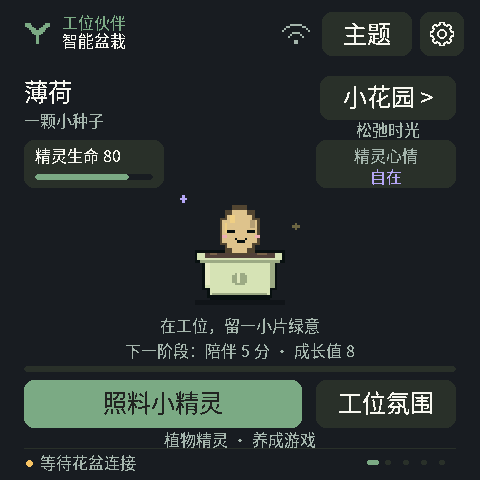
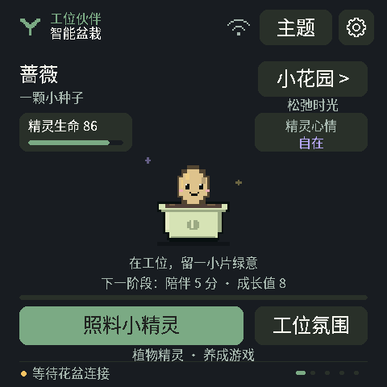

# 界面与接线预览

当前 Indicator 使用 Worker Smart Planter 像素界面，首页已加入植物精灵养成：薄荷、九层塔、蔷薇和多肉各自保存成长进度，支持浇水、施肥、除草、陪伴、精灵生命与心情，以及工位氛围选择。原有中英文、Wi-Fi、亮度设置和五页导航保留。

以下预览直接运行生产固件的绘图、养成模型与交互代码，网络和硬件边界在本机替换为离线状态，不控制设备。GIF 不是实机拍摄或实测帧率。v3 已通过 COM13 刷入，并完成 20 秒正常启动日志检查；实机游戏体验仍待用户验收，详见[养成版本记录](../deployment/indicator-garden-ui.md)。

当前动效已固定植物与花盆的位置，去掉整株左右平移、种子上下跳动和短促的第二次眨眼，保留单次眨眼、周围星光和照料反馈。眨眼逻辑窗口为 260 毫秒，GIF 按主机 100 毫秒采样展示；实体屏幕的刷新稳定性仍需结合实机验证。

[查看养成操作总览](indicator-garden-overview.png)。下面是蔷薇的五阶段图鉴，每阶段展示 800 毫秒，用于比较外观，**不是实际成长速度**。

更新原生预览可运行 `tools/render-indicator-ui.ps1`，默认生成到本机 `build/indicator-preview-v3/`；使用说明见[原生渲染器](../../tests/render/README.md)。工具拒绝覆盖历史 `build/indicator-preview/` 和 `build/indicator-preview-v2/` 目录。[第一版动画](indicator-worker.gif)、[第一版总览](indicator-worker-overview.png)、[设置版动画](indicator-settings.gif)、[设置版主页面](indicator-settings-main.png)和[设备设置页](indicator-settings-menu.png)保留作历史对照；设置版本的记录见[这里](../deployment/indicator-settings-ui.md)。

本轮生成 562 帧 PNG、9 个 GIF 和 17 张对照图。`garden-growth-overview.png` 展示四种植物各五阶段；`zh-garden-overview.png` 与 `en-garden-overview.png` 展示中英文照料、冷却反馈、物种和工位氛围。原有 `zh-main-overview.png`、`en-main-overview.png`、`zh-settings-overview.png`、`en-settings-overview.png` 继续覆盖五页、主题、操作确认、设置、Wi-Fi 空列表、关于与键盘。字体为 493 字符，每个字符都有 16、24、32、48、64 像素五种原生字号。

40 项实际主界面交互断言覆盖原有硬件确认与设置隔离，并新增虚拟照料、冷却、物种进度保留、工位氛围、触摸隔离及专注完成奖励；另有 44 项阶段夹具有效性断言和 84 项固定位置／眨眼像素断言。18 张中英文设置预览与 v2 逐像素一致，中英文养成页面已目视复查。预览使用真实养成模型，存储替身只在主机 RAM 中运行，不访问设备 NVS。阶段图鉴通过明确标记的游戏存档夹具展示外观，精灵生命与心情不代表真实植物诊断或传感器读数。持久化行为另由模型／存储测试验证。

显示提交失败另有 6 项主循环回归：注入一次帧提交失败后，真实主循环停止绘制与后续提交，帧缓冲像素保持不变，并只记录一次错误。主机仅模拟提交成功或失败，不模拟 VSYNC、DMA 或实体 LCD 刷新。

设置截图中的后端、存储和背光也是主机模拟；网络名仅用 `example` 样例，没有真实扫描、密码或外网连接。`manifest.json` 标记这些样例与游戏夹具，记录生产 UI、模型、字体、渲染器和测试边界的来源哈希。预览中的亮度数值不构成物理测量；用户已确认的 v2 字体、亮度和 Wi-Fi 扫描验收与本轮游戏验收分开记录。

## 接线与早期交互原型

下载仓库后，用浏览器打开以下独立 HTML。GitHub 文件页展示源码，不直接运行界面；当前未启用 GitHub Pages 或其他公开托管。

- [接线与通信示意图](roboplanter-wiring.html)：查看 XIAO、Indicator、传感器与供电连接。
- [旧版 Indicator 桌边伙伴](indicator-companion.html)：早期五页导航与番茄钟交互原型，其主题与画面已被新版像素界面替代。

预览不会连接或控制真实硬件；照片与读数保持未接入状态。真实接线以 [接线文档](../wiring.md) 为准，实机功能与照片导入步骤见 [Indicator UI](../indicator-ui.md)。

`source/` 保存可编辑的原始片段，外层 HTML 是独立浏览器包装。界面布局用于交互设计预览，实际屏幕字形、刷新速度和触摸效果仍需实机验收。
