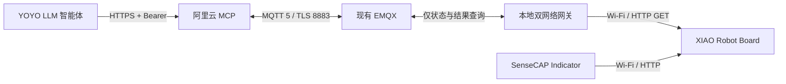

# 阿里云 MCP 与 MQTT 查询链路

2026-10-24 已部署云端服务；实际部署与验证结果见 [部署记录](INFRA-DEPLOYMENT.md)。当前为只读联调版本，设备尚未接入。六个 MCP 工具可发现，四个动作工具（包括停止浇水）固定返回 `rejected / cloud_writes_not_enabled / sent=false`。不要把云服务存活或 MQTT 登录成功当作真实花盆在线。

## 网络关系



XIAO 目前只开热点 `192.168.4.1`，不是互联网客户端。网关电脑需要一条网络连 XIAO 热点，另一条网络上网，例如 Wi-Fi + 有线网络。Indicator 和网关使用 XIAO 的两个 AP 客户端位置。不要把网关程序部署在云主机后就期待云主机可以访问本地 `192.168.4.1`。

## 云端地址与认证

- Streamable HTTP：`https://emqx.robomon.cn/roboplanter/mcp`
- SSE：`https://emqx.robomon.cn/roboplanter/sse`；消息地址由 SDK 通过事件返回。
- 存活检查：`https://emqx.robomon.cn/roboplanter/healthz`，只表示 HTTP 进程存活，不表示 MQTT 或设备就绪。
- MCP 请求必须携带 `Authorization: Bearer <ROBOPLANTER_CLOUD_TOKEN>`。不接受 URL query、cookie 或省略认证；不要把密钥填到提示词、技能包或 Git。

宿主机 Nginx 终止 HTTPS，剥离 `/roboplanter/` 前缀后代理到 `127.0.0.1:18765`。容器端口为 8765，非 root、只读文件系统、192 MB 内存上限。公网不直接开放这个 HTTP 端口。

## 本地网关

在仓库根目录安装依赖：`python -m pip install -r integrations/cloud/requirements.txt`。如使用当前工作区 bundled Python，也可安装到 `.tools/mcp-python`，入口会自动载入该目录。

将花盆网关专用的 MQTT 配置载入进程环境，并配置本地设备地址与设备令牌，然后运行：

```text
ROBOPLANTER_MQTT_HOST=mqtt.robomon.cn
ROBOPLANTER_MQTT_PORT=8883
ROBOPLANTER_MQTT_USERNAME=roboplanter-gateway
ROBOPLANTER_MQTT_PASSWORD=<网关专用密码>
ROBOPLANTER_MQTT_DEVICE_ID=roboplanter-01
ROBOPLANTER_URL=http://192.168.4.1
ROBOPLANTER_TOKEN=<与固件一致的非默认设备令牌，至少16字符>
```

```sh
python -m integrations.cloud.gateway
```

程序不自动读取 `.env`；启动器需要先加载上述环境变量。设备令牌只保存在本地网关，云端只保存自己的 MQTT 账号及 MCP token。本工作区的 `.env.cloud`、`.env.gateway` 是私有部署凭据，不在 Git 中；`.env.gateway` 不包含尚未确定的设备令牌。

网关只允许 `get_state` 和 `get_result`，不提供任意 URL 或写命令转发。关闭网关后，云端在心跳过期或查询超时后返回不可用。设备缺失/HTTP 失败也返回不可用，绝不生成示例读数。

## MQTT 隔离与时效

固定主题前缀为 `roboplanter/v1/roboplanter-01/`。云账号只能发布 `query`、订阅 `reply` 和 `presence`；网关账号权限相反。两个账号均不是 superuser，其他主题及 retained 发布被拒绝；没有为云端配置动作主题。

MQTT 5 使用 TLS 证书校验、QoS 0、不保留消息、Clean Start 和零 Session Expiry。每次重连更换会话标识；查询带 RPC ID 和 6 秒有效期，心跳每 5 秒发送、20 秒过期。两端系统时钟需同步。结果会把完整 RPC 耗时加入原始读数年龄，不用收到消息的时间冒充采样时间。

## 后续启用写操作前

需要增加设备启动标识与执行截止时间协议、云端及网关的持久化动作账本，并验证断网、重连、重启和重复消息不会重复执行。随后刷写和测试真实 XIAO、水泵、灯带及打印机。当前没有用于绕过限制的环境变量；不能通过把布尔开关设为 true 就启用云端浇水。

## 验证

```sh
python -m unittest integrations.cloud.test_server integrations.cloud.test_mqtt -v
```

入口测试使用官方 MCP SDK 验证两种传输、认证、Host/Origin、请求限长和禁写。MQTT 单元测试检查超时、会话、retained、断连和新鲜度。真实 EMQX/公网验证与真机验收应分别记录，不能用模拟结果替代真实设备结果。
